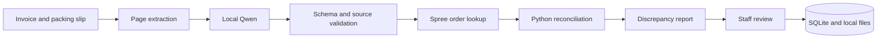

# BDA | Commerce Document Intelligence Agent

BDA compares invoices and packing slips with Spree order records. It extracts
source-backed document fields, checks quantities and invoice arithmetic, and saves
structured discrepancy reports for staff review. The dashboard keeps documents,
findings and model conversations in one workspace.

## Features

- Text PDF, TXT and Markdown document parsing with page references.
- Local Qwen extraction into validated document schemas.
- Source-quote checks for extracted identifiers, quantities and amounts.
- Exact order-reference matching and read-only Spree integration.
- SKU quantity reconciliation, line arithmetic and subtotal checks using Decimal.
- Duplicate-upload handling and persistent review decisions.
- Browser conversations grounded in a selected report.
- Light and dark themes, responsive layouts and JSON report downloads.

## Architecture



The model extracts document fields. Python validates their source evidence and
calculates differences. Staff review the findings before accepting the internal
report. Approvals do not modify Spree records.

| Component | Technology |
| --- | --- |
| Application API | Python 3.13, FastAPI, Pydantic |
| Local inference | Ollama, Qwen 3 |
| PDF parsing | pypdf |
| Commerce integration | HTTPX, Spree 6 Admin API v3 |
| Reconciliation | Python Decimal |
| Persistence | SQLite and local file storage |
| Dashboard | HTML, CSS, JavaScript |
| Automated checks | pytest, GitHub Actions |

[Architecture and API reference](docs/architecture.md)

## Installation

Install Python 3.13, Git and Ollama. Keep Ollama running in the background.
For live order access, run a Spree 6 store separately.

```powershell
git clone https://github.com/Emmanuel-Rono/BDA.git
cd BDA
py -3.13 -m venv .venv
.\.venv\Scripts\python.exe -m pip install -r requirements.lock.txt
.\.venv\Scripts\python.exe configure.py
ollama pull qwen3:1.7b
```

`configure.py` creates a private `.env` and server signing key without replacing
existing configuration. The dashboard opens a local browser session automatically;
users do not enter service keys in the interface.

## Configuration

The default `SPREE_MODE=fixture` uses the sample order in `examples/store.json`.
Document extraction still runs through the local Ollama model.

For live Spree access, edit `.env`:

```dotenv
SPREE_MODE=live
SPREE_BASE_URL=http://localhost:3000
SPREE_API_KEY=sk_your_read_only_key
STORE_ID=your_store_id
```

Use a secret key scoped to `read_orders`, `read_fulfillments` and `read_products`.
Both documents must state the same exact order number. SKUs are compared with
that order's items. Keep credentials and store-specific files in private storage.

## Run

```powershell
.\.venv\Scripts\python.exe -m uvicorn app.main:create_app --factory --host 127.0.0.1 --port 8002 --workers 1
```

Open [localhost:8002](http://localhost:8002).

1. Upload an invoice and packing slip in **Assistant**.
2. Select **Compare documents**.
3. Inspect the quantity comparison, source pages and extracted fields.
4. Ask follow-up questions in the conversation panel.
5. Add a review note and approve or reject the internal report.

**Documents** lists the sources attached to processed reports. **Reports** opens saved
comparisons. **Settings** controls appearance and connection checks. The model loads
when a request is submitted. Run one comparison at a time on CPU.

## Sample workflow

In fixture mode, select **Try the demo documents** or upload `examples/invoice.pdf`
and `examples/packing-slip.pdf`. The sample order contains three units, the invoice
lists three, and the packing slip lists two. The report flags a difference of one unit.

For a live store, upload documents referencing your own order. The sample button
reads local files named `live-invoice.txt` and `live-packing-slip.txt` from
`data/examples/`. These store-specific documents stay outside version control.

## Testing

Run the automated suite without starting Spree or loading a model:

```powershell
.\.venv\Scripts\python.exe -m pytest -q --junitxml=reports/tests.xml
```

The suite covers document parsing, source evidence, exact arithmetic, order matching,
currency rules, duplicates, persistence, review decisions, browser sessions, request
origins and model-conversation API contracts.

Run the integration check using the bundled fixture documents:

```powershell
.\.venv\Scripts\python.exe verify_integration.py
```

For documents from your live store:

```powershell
.\.venv\Scripts\python.exe verify_integration.py --invoice C:\documents\invoice.pdf --packing-slip C:\documents\packing-slip.pdf
```

The integration check uses the configured local model and order source, validates
the comparison, checks duplicate handling, approves an internal report and verifies
the saved decision. It uses a temporary application database and saves its result
in `reports/integration.json`. Spree records remain unchanged.

GitHub Actions runs the isolated pytest suite on pushes and pull requests and
uploads JUnit results. Integration checks use separately configured local services.

## Repository structure

```text
app/                    API, parsing, extraction, reconciliation and persistence
static/                 Dashboard, themes and browser interactions
examples/               Portable sample documents and order fixtures
tests/                  Automated application and access-control tests
docs/architecture.md    Design decisions and API reference
configure.py            Private environment setup
verify_integration.py   Explicit integration check using local services
requirements.lock.txt   Pinned application and test dependencies
```

## Operating scope

BDA processes English text documents, whole-unit quantities and USD line amounts
with two decimal places. Files are limited to 2 MB and 10 pages; model extraction
accepts up to 10,000 characters per document. Image-only pages require OCR and are
rejected by this text-document workflow.

Checks compare order, invoice and packed quantities; quantity multiplied by unit
price; and the sum of invoice line totals against the subtotal. Grand totals are
not compared with order totals because shipping, discounts and taxes are separate
charges. Quantity differences are review items; staff check partial-shipment records
before classifying them as missing stock.

The application serves one configured store and one local staff workspace. Browser
sessions use signed HttpOnly cookies and origin checks. Processing is synchronous
and runs in one server worker. Interrupted jobs are marked failed after restart.

Original documents, reports, review notes and credentials stay in private local
storage. They are excluded from version control. Back up `.env` and `data/` privately
before replacing an installation.
