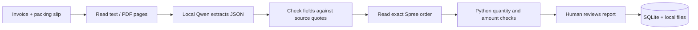

# BDA — Commerce Document Intelligence Agent

BDA reads an invoice and packing slip, extracts fields with local Qwen, and checks
their quantities against a Spree order. Every extracted value carries a page and
source quote. Python calculates differences using Decimal. Staff review the report;
approval saves it locally without changing inventory, orders or payments.

## Simple design



One Python app, one SQLite database and a plain web page. There is no agent
framework or autonomous tool loop here: this first version is a fixed AI-assisted
document workflow. That makes matching and financial checks easier to explain.

## Install and run

Use Python 3.13 and start Ollama. Prepare the model:

```powershell
ollama pull qwen3:1.7b
py -3.13 -m venv .venv
.\.venv\Scripts\python.exe -m pip install -r requirements.lock.txt
.\.venv\Scripts\python.exe configure.py
.\.venv\Scripts\python.exe -m uvicorn app.main:create_app --factory --host 127.0.0.1 --port 8002 --workers 1
```

Open **http://localhost:8002**. Copy `APP_API_TOKEN` from the private `.env` into
the access form. Click **Run demo document pair**, or upload the two files under
`examples/`. The invoice lists three units; the packing slip lists two.
The expected difference is minus one, which requires review.

Default `SPREE_MODE=fixture` uses clearly labelled demo records. The extraction
still uses actual local model inference. Live failures never fall back to fixtures.

## Connect Spree

The adapter targets Spree 6.0.6, Admin API v3. Configure a read-only server key:

```dotenv
SPREE_MODE=live
SPREE_BASE_URL=http://localhost:3000
SPREE_API_KEY=sk_your_read_only_key
STORE_ID=your_actual_store_id
```

Use `read_orders,read_fulfillments,read_products` scopes. Both uploaded documents must explicitly
reference the same exact order number and contain SKUs matching its items.
The `examples/live-order.json` file, when supplied, records this machine's demo
reference. Use your own references when installing elsewhere.

## Checks and evidence

```powershell
.\.venv\Scripts\python.exe -m pytest -q --junitxml=reports/tests.xml
.\.venv\Scripts\python.exe verify_demo.py
```

Unit/API tests use doubles. The separate verification command performs actual
model extraction, source validation, configured order access, quantity comparison,
duplicate handling and approval. Its result and measured duration are saved in
`reports/real-model-smoke.json`. See [verification](docs/verification.md).

| File | What it does |
| --- | --- |
| `app/main.py` | Accept files, persist a job, run the workflow |
| `app/documents.py` | Validate input and preserve PDF/text page numbers |
| `app/extraction.py` | Define extraction fields and verify exact source quotes |
| `app/reconcile.py` | Match references, aggregate SKU quantities, check arithmetic |
| `app/spree.py` | Read-only order access and explicit fixture mode |
| `app/model.py` | Local Ollama inference and JSON-schema validation |
| `app/storage.py` | Persistent jobs and versioned staff reviews |
| `static/` | Plain HTML, CSS and JavaScript |

The model reads the document; ordinary Python decides whether values match.
Missing values stay null. It never guesses an order reference. Repeated uploads
of the same document pair return the existing job instead of re-running inference.
Failed pairs also return their saved result; correcting the document creates a new
hash. Repeated approvals with the same version and note are idempotent.

## Current limits

- English clean-text PDFs, TXT and Markdown only. Maximum 2 MB, 10 pages and
  50,000 parsed characters per file; the model workflow accepts at most 10,000. Documents with image-only pages need OCR.
- Whole-unit quantities and USD amounts with two decimal places. No currency
  conversion, translation, supplier purchase-order workflow or scanned OCR yet.
- Checks cover order/invoice/packing quantities, quantity × unit price, and sum
  of invoice line totals. Grand total is not compared with the order because
  shipping, discounts and taxes may differ. A quantity difference may be a partial
  shipment; it is a review item, not proof of a warehouse mistake.
- Source-quote validation reduces unsupported extraction but does not prove table
  interpretation is perfect. Review every discrepancy against the source pages.
- Original files, extracted fields and review notes remain local under `data/`.
  Review notes preserve corrections; a field-editing interface is future work.
- One configured store and one demo staff token. There are no multi-user roles.
- Synchronous processing, one server worker. Interrupted jobs are marked failed
  after restart. A durable worker queue is future work.
- Shared policy RAG, Docling/OCR, multilingual evaluation and production auth from
  the larger project plan are not part of this first demonstrable workflow.

## Sharing and deployment

`docker compose up --build` runs BDA on port 8002 with its own data volume.
Docker Desktop resolves host Ollama/Spree through `host.docker.internal`.
The Dockerfile is supplied; build results are recorded in the verification note.
The base Python image uses a minor-version tag, not an immutable/offline bundle.

Publish this folder as its own GitHub repository. It does not import COA and can
run without it. Small infrastructure files are duplicated deliberately to keep
both beginner projects independent; maintain both when fixing shared behaviour.
CI runs isolated tests on push/PR. Real model and Spree checks run separately.
Do not commit `.env`, `data/`, tokens or private reports. Share the source, verified
status and a short recording. GitHub hosts source code, not this Python server.

Before upgrades, privately back up `.env` and `data/`. Restore them with the matching
source version to roll back. Stop and archive `data/` for a fresh demo database.

Built with AI coding assistance. Review the workflow and tests before presenting
it as work you can independently explain.

References: [Ollama structured outputs](https://docs.ollama.com/capabilities/structured-outputs),
[Spree Admin API](https://spreecommerce.org/docs/api-reference/admin-api/authentication),
[pypdf text extraction](https://pypdf.readthedocs.io/en/stable/user/extract-text.html).
